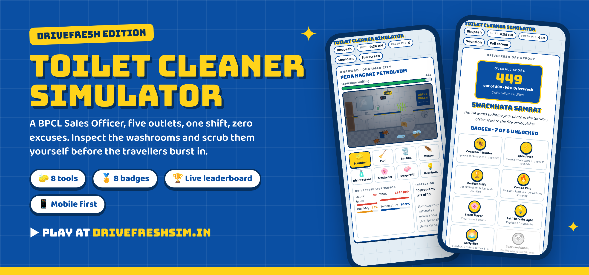
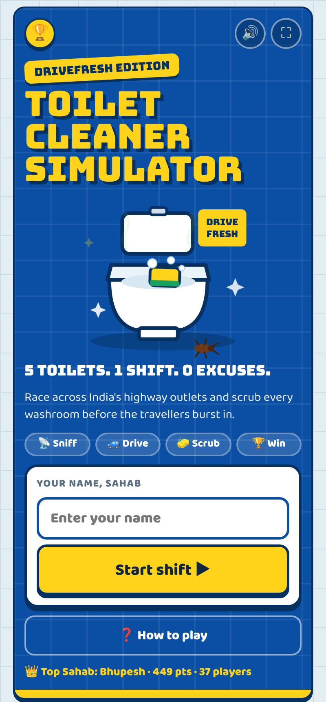
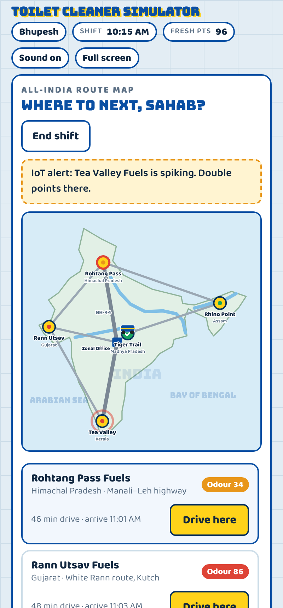
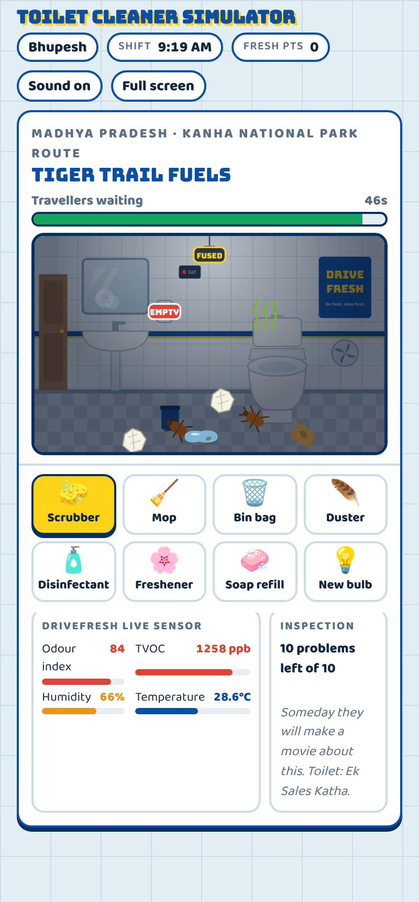
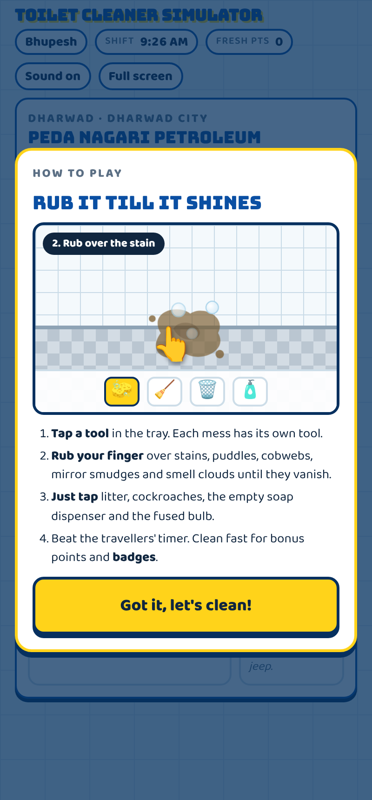
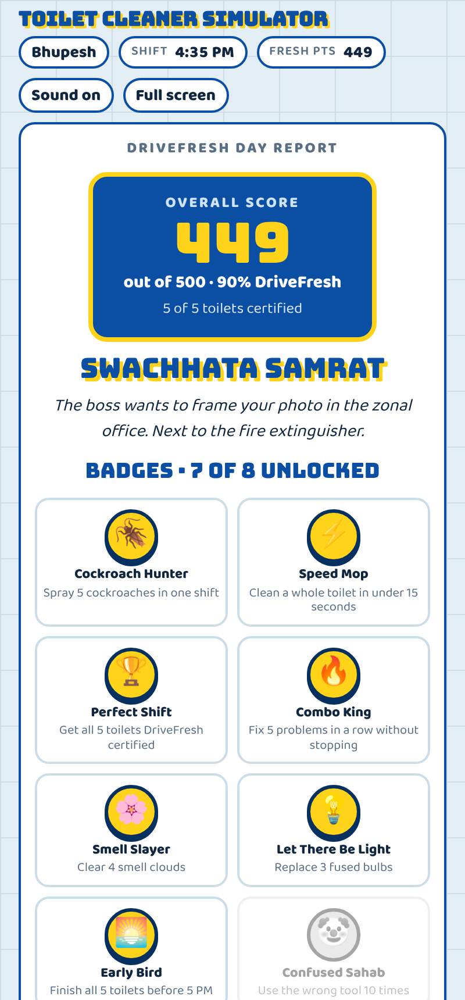
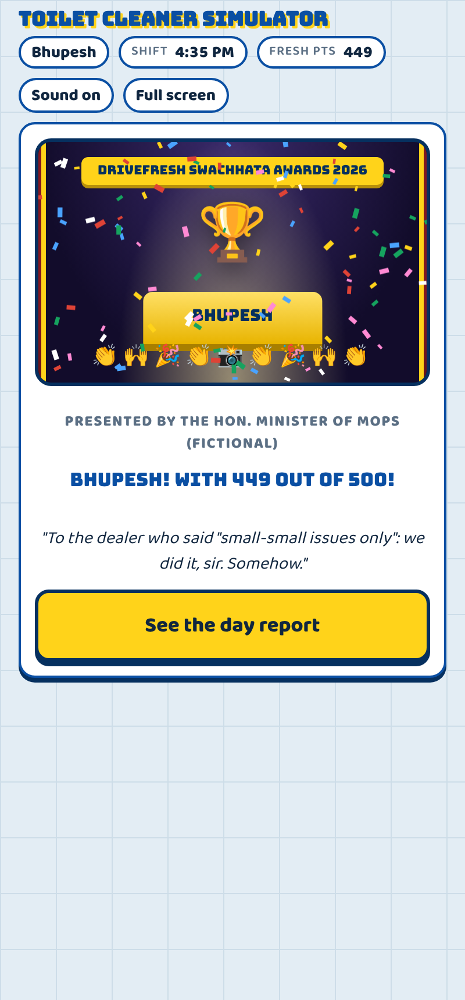
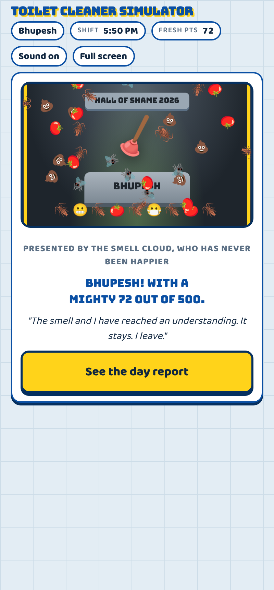
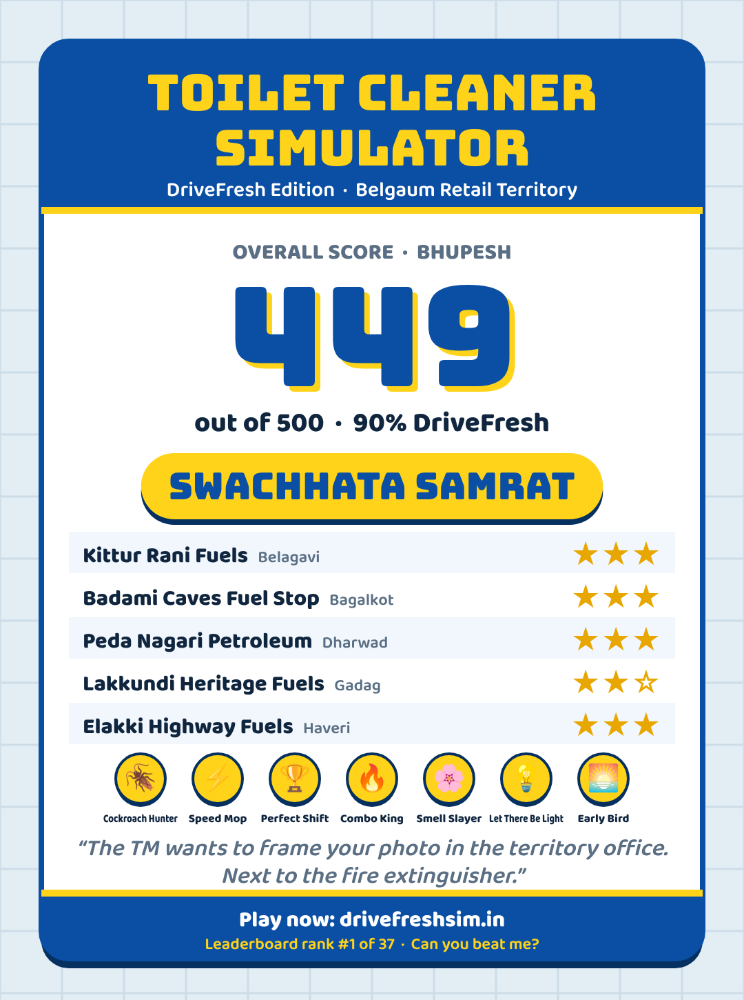

<div align="center">

<a href="https://drivefreshsim.in"></a>

<br>

[](https://drivefreshsim.in)


### *Be fresh, drive fresh.* 🌸

**A Sales Officer. Five outlets. One shift. Zero excuses.**

</div>

---

## 🚽 What is this?

**Toilet Cleaner Simulator** is a fun, fast mobile game built around **DriveFresh**, BPCL's initiative for clean, safe and hygienic washrooms at fuel stations.

You play a **Sales Officer** with a suspiciously fast jeep. Your job today is to tour five outlets on tourist routes across India, from the **Manali–Leh highway** and the **White Rann of Kutch** to **Kanha**, **Kaziranga** and the **tea gardens of Munnar**. Read the live DriveFresh odour sensors and inspect every washroom. If one fails inspection, there's no time to write a letter. You grab the scrubber yourself.

Beat the travellers' timer, dodge the dealer's excuses, unlock badges, and climb the leaderboard. Score big and you walk the red carpet. Score badly and, well, Raju the Cockroach has an award for you too.

> *"Sir, the cockroach is a pet. Children named him Raju."*
> — An actual dealer, in the game

---

## 📸 Screenshots

<div align="center">
<table>
<tr>
<td align="center"><br><sub><b>Landing page</b></sub></td>
<td align="center"><br><sub><b>All-India map + odour sensors</b></sub></td>
<td align="center"><br><sub><b>Scrub, mop, spray</b></sub></td>
<td align="center"><br><sub><b>How-to-play guide</b></sub></td>
<td align="center"><br><sub><b>Day report + badges</b></sub></td>
</tr>
</table>
</div>

---

## 🏆 The awards night (and the hall of shame)

Finish the shift with **400+ out of 500** and the curtains open on the **DriveFresh Swachhata Awards**: drumroll, spotlight, fanfare, confetti, a golden trophy and a cheering crowd. Then you give your acceptance speech.

Finish with **under 100** and you're inducted into the **Hall of Shame** instead: sad trombone, falling tomatoes, an applauding audience of cockroaches, and the coveted **Rusty Plunger**.

<div align="center">
<table>
<tr>
<td align="center"><br><sub><b>400+ · Swachhata Award</b></sub><br><sub><i>"I dedicate this to my mother, who still thinks I sell petrol."</i></sub></td>
<td align="center"><br><sub><b>Under 100 · Rusty Plunger of Shame</b></sub><br><sub><i>"In my defence, the cockroach had seniority."</i></sub></td>
</tr>
</table>
</div>

---

## 🎮 How to play

1. **Enter your name** so your score lands on the leaderboard.
2. **Pick an outlet on the map.** Each one shows its live **odour index** 🟢🟠🔴. Driving costs shift time, and the day ends at **6 PM**, so plan your route.
3. **Listen to the dealer's excuse.** Then go in and inspect.
4. **Choose the right tool and clean.** Rub over the mess, or tap it, before the travellers' timer runs out.
5. **Get rated.** Stars, before-and-after sensor readings, a dealer stamp from *"DriveFresh certified"* to *"Show-cause notice"*, and a brutally honest traveller review.
6. **Finish the shift.** Collect your award (or your plunger), then share your score card on WhatsApp.

### 🧰 The toolkit

| Tool | | Fixes | How |
|:--|:-:|:--|:--|
| Scrubber | 🧽 | Stains | Rub |
| Mop | 🧹 | Puddles | Rub |
| Bin bag | 🗑️ | Litter | Tap |
| Duster | 🪶 | Cobwebs | Rub |
| Disinfectant | 🧴 | Mirror smudges, cockroaches | Rub / Tap |
| Freshener | 🌸 | Smell clouds | Rub |
| Soap refill | 🧼 | Empty dispenser | Tap |
| New bulb | 💡 | Fused bulb (the room is dark until you fix it) | Tap |

> On desktop, keys **1–8** switch tools.

### 🛣️ On the road

Random events keep every shift different: a lorry jam on the bypass, masala chai from the dealer (+8 seconds), a monsoon shower (extra puddles), jasmine freshener stock (2× faster), and the big one, a **DriveFresh IoT alert** that doubles your points at a spiking outlet.

---

## 🏅 Badges

| | Badge | How to unlock |
|:-:|:--|:--|
| 🪳 | **Cockroach Hunter** | Spray 5 cockroaches in one shift |
| ⚡ | **Speed Mop** | Clean a whole toilet in under 15 seconds |
| 🏆 | **Perfect Shift** | Get all 5 toilets DriveFresh certified |
| 🔥 | **Combo King** | Fix 5 problems in a row without stopping |
| 🌸 | **Smell Slayer** | Clear 4 smell clouds |
| 💡 | **Let There Be Light** | Replace 3 fused bulbs |
| 🌅 | **Early Bird** | Finish all 5 toilets before 5 PM |
| 🤡 | **Confused Sahab** | Use the wrong tool 10 times *(achievement unlocked: embarrassment)* |

### 🎖️ Ranks

| Rank | What it means |
|:--|:--|
| 👑 **Swachhata Samrat** | The boss wants to frame your photo in the zonal office. Next to the fire extinguisher. |
| 🥇 **DriveFresh Champion** | Dealers now hide when they see your jeep. That is respect. |
| 🧹 **Mop Apprentice** | Good effort. The cockroaches are still talking about you. Mostly laughing. |
| 📚 **Refresher training booked** | Topic: which end of the mop to hold. |

---

## 📲 Share your score

At the end of every shift the game draws a **score card image** with your score, rank, star rating for each toilet, badges, a punchline and the game link. Tap **Share on WhatsApp** to send it straight to your team group.

<div align="center">

</div>

---

## ✨ Features

- 📲 **Installable app (PWA).** Add it to your home screen and it opens full screen with its own icon, like a real app. It even works offline.
- 📱 **Mobile-first.** Big thumb-friendly tool tray, full-screen mode, haptics, landscape support and a screen that stays awake while you clean.
- 📡 **DriveFresh sensor panel.** Odour index, TVOC, humidity and temperature drop live as you clean.
- 🗺️ **All-India route map** with five DriveFresh-style tourist routes.
- 🎭 **Awards ceremony** for 400+ scores, and a **Hall of Shame** for under 100.
- 🏆 **Live leaderboard** powered by Google Sheets, using each player's best score.
- 🏅 **8 badges** and **4 ranks** to chase.
- 😂 **100+ jokes.** Dealer excuses, traveller reviews, wrong-tool roasts, combo streaks and the Sales Officer's inner monologue.
- 🧭 **Animated how-to-play guide** on the first launch.
- 🔊 **Sound effects** built in code, with no audio files to download.
- ⚡ **One HTML file.** No framework, no build step, no app store.

---

## 🛠️ Tech stack

| Part | Built with |
|:--|:--|
| Game | Vanilla HTML, CSS and JavaScript in a single `index.html` |
| Graphics | Hand-drawn inline SVG + CSS animation |
| Score card | HTML Canvas, shared via the Web Share API |
| Sounds | Web Audio API |
| Leaderboard | Google Apps Script web app + Google Sheets |
| Hosting | GitHub Pages with a custom domain |
| Install & offline | Web app manifest + service worker (PWA) |
| Fonts | Bungee + Baloo 2 (Google Fonts) |

### 📁 Project structure

```
DriveFresh_sumilator/
├── index.html              # The entire game
├── manifest.webmanifest    # PWA: app name, icons, colours
├── sw.js                   # PWA: offline cache (bump VERSION on each update)
├── CNAME                   # Custom domain for GitHub Pages
├── Code.gs                 # Leaderboard backend (paste into Google Apps Script)
├── README.md
├── icons/                  # App icons (192, 512, maskable, Apple, favicon)
└── assets/
    ├── banner.png
    └── screenshots/
```

---

## 📲 Install it like an app

| Phone | How |
|:--|:--|
| **Android (Chrome)** | Open [drivefreshsim.in](https://drivefreshsim.in) and tap the yellow **📲 Install app** button, or use **⋮ → Install app** |
| **iPhone (Safari)** | Open the site, tap **Share ⬆️ → Add to Home Screen** |
| **Desktop (Chrome / Edge)** | Click the install icon at the right end of the address bar |

Once installed, it opens full screen with no browser bars and works offline. The leaderboard syncs whenever you're back online.

---

## 🚀 Run it yourself

**Play locally:** download `index.html` and open it in any browser. That's it. (The install and offline features need the site served over HTTPS, which GitHub Pages does for you.)

**Updating the game:** after you change `index.html`, bump `VERSION` at the top of `sw.js` (for example `v1` → `v2`) so installed copies pick up the new version.

**Set up your own leaderboard:**

1. Create a new **Google Sheet**.
2. Open **Extensions → Apps Script**, paste in [`Code.gs`](Code.gs), and save.
3. Choose **Deploy → New deployment → Web app**, with *Execute as: Me* and *Who has access: Anyone*.
4. Copy the web app URL (it ends in `/exec`) and paste it into `SCOREBOARD_URL` near the top of the script in `index.html`.
5. Push to GitHub and enable **Settings → Pages**.

Scores land in a **Scores** tab with the time, name, score, rank title, toilets certified and badges.

---

## 👨‍💻 Meet the developer

<table>
<tr>
<td width="140" align="center">
<a href="https://github.com/pro-bhupesh"></a>
</td>
<td>

### Bhupesh Kumar Bajiya

I made this game to turn DriveFresh, a campaign about something nobody likes talking about, into something people actually *want* to play and share. If a few laughs get more washrooms cleaned on the highway, mission accomplished.

[](https://github.com/pro-bhupesh)

</td>
</tr>
</table>

---

## 🤝 Contributing

Got a funnier dealer excuse? A traveller review that made your whole team laugh? **Open an issue or a pull request.** The joke banks live near the top of the script in `index.html`, in arrays like `DEALER_DIRTY`, `TRAVELLER` and `KNOCKS`.

---

## ⚠️ Disclaimer

This is a fan-made awareness game created to support the spirit of the DriveFresh initiative. It is **not an official BPCL product**. All outlet names, dealers, travellers and cockroaches are fictional, and any resemblance to real toilets is purely coincidental. 🪳

<div align="center">

<br>

**Made with 🧽, 🌸 and far too many toilet jokes in Karnataka.**

[](https://drivefreshsim.in)

</div>
